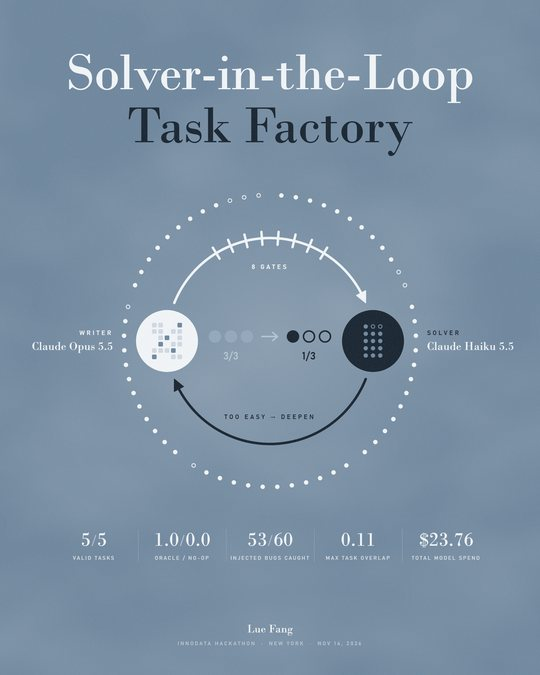
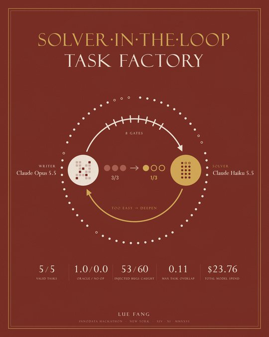
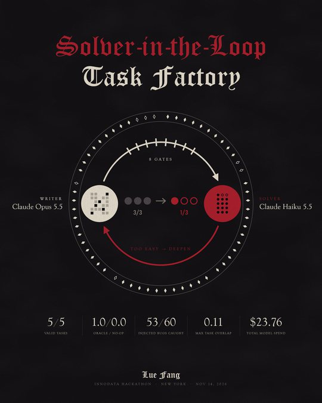
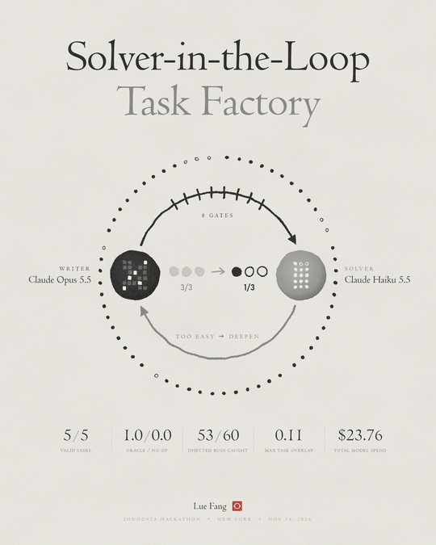
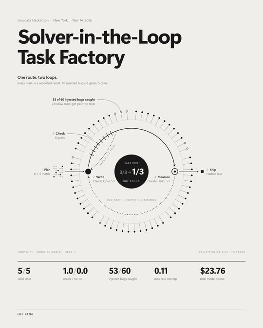
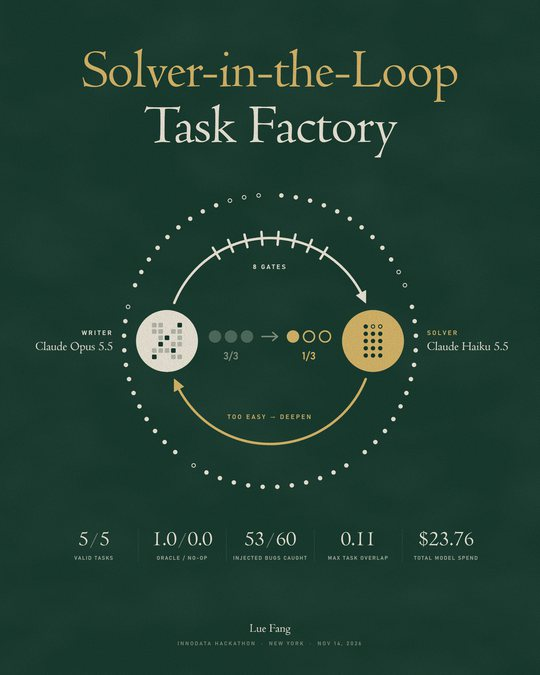
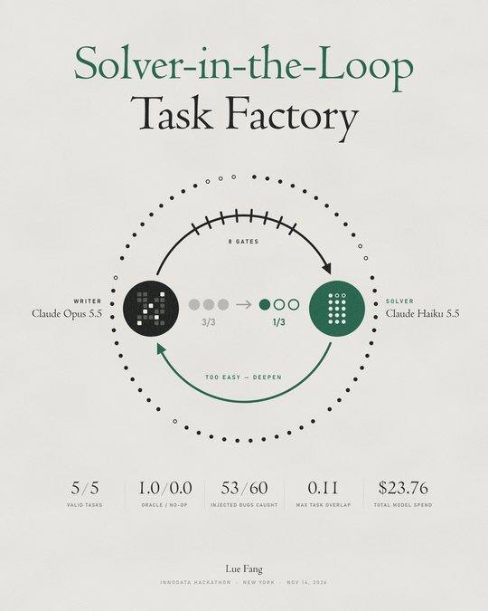

# The poster

One picture of the Solver-in-the-Loop Task Factory, drawn in seven styles.

The style changes. The records do not: every mark is a recorded fact from the project's runs, and nothing is decoration.

<p align="center">
  <a href="poster_cloth_en.jpg"></a>
</p>

## What each mark records

| Mark | Record |
|---|---|
| Outer ring | The 60 bugs injected into the reference solutions, 12 per task, in five groups. A hollow mark is a bug the generated tests missed. 53 of 60 were caught. |
| Left disc | The writer, Claude Opus 5.5, holding the 6 × 5 variation matrix. Solid cells are the five tasks of this batch. Faint cells are the other allowed pairs. |
| Eight bars | The eight checks between the writer and the solver. |
| Right disc | The solver, Claude Haiku 5.5, holding its 15 attempts on the shipped tasks, three per task. A hollow mark is an attempt that did not solve the task. |
| Centre | Task 0101: solved 3 of 3 times before it was made harder, 1 of 3 after one round. |
| Numbers | 5 of 5 tasks valid. Harbor oracle 1.0, no-op 0.0. Largest overlap between two tasks 0.11. 23.76 USD of model spend. |

## Seven styles

<table>
  <tr>
    <td align="center"><a href="poster_haze_en.jpg"></a><br><b>haze</b><br>haze blue, Bodoni</td>
    <td align="center"><a href="poster_roman_en.jpg"></a><br><b>roman</b><br>Pompeian red, marble and gold</td>
    <td align="center"><a href="poster_gothic_en.jpg"></a><br><b>gothic</b><br>black, bone and crimson</td>
    <td align="center"><a href="poster_ink_en.jpg"></a><br><b>ink</b><br>ink wash, one cinnabar seal</td>
  </tr>
  <tr>
    <td align="center"><a href="poster_lupi_en.jpg"></a><br><b>lupi</b><br>one hairline per record</td>
    <td align="center"><a href="poster_cloth_en.jpg"></a><br><b>cloth</b><br>green book cloth, bone and gold</td>
    <td align="center"><a href="poster_stone_en.jpg"></a><br><b>stone</b><br>ink and viridian on stone paper</td>
    <td></td>
  </tr>
</table>

Each thumbnail opens the full poster (2160 × 2700). The Chinese versions are `poster_<style>_zh.jpg`.

## Rebuild it

`poster.html` draws the picture from the numbers written in the file. Open it in a browser and add `?style=ink` (or any name above), and `&lang=zh` for Chinese captions.

```
python social/render.py
```

This exports every style in both languages with a headless Edge or Chrome.

The pipeline the poster describes is in [`factory/`](../factory).
